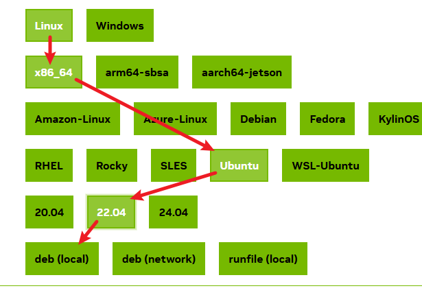
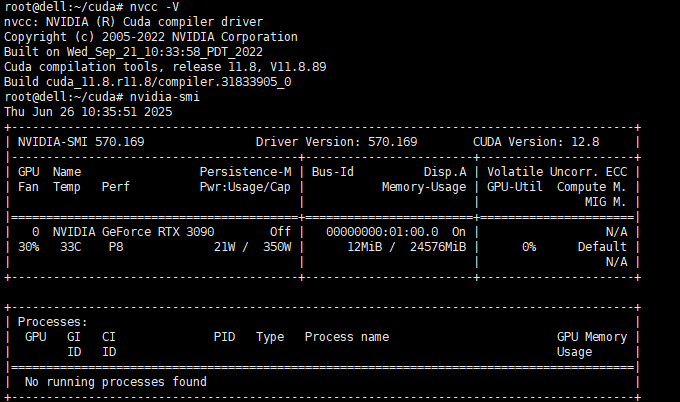
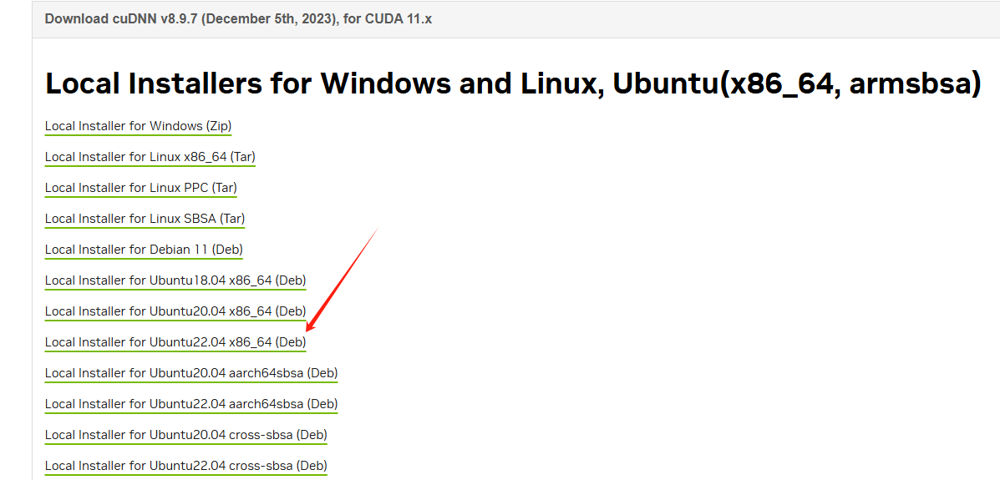
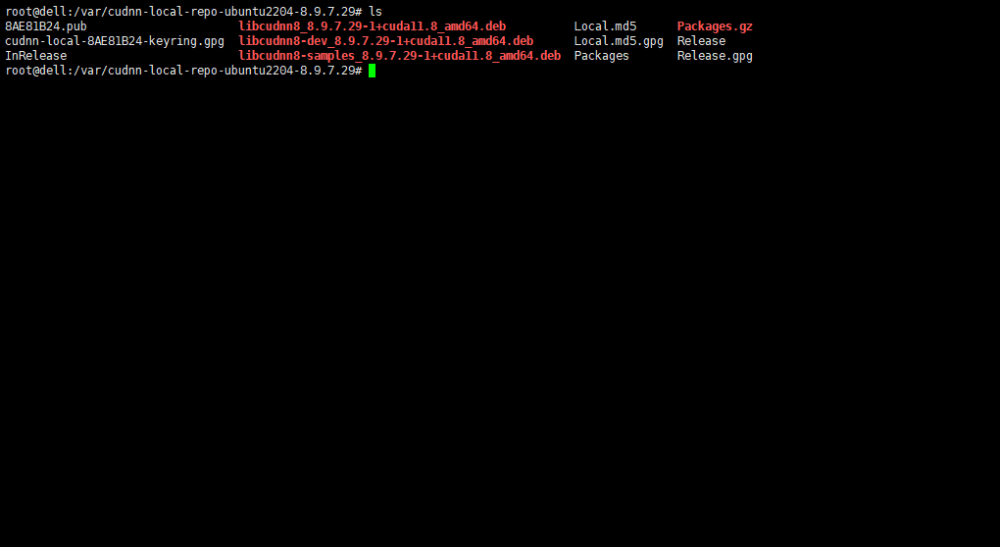
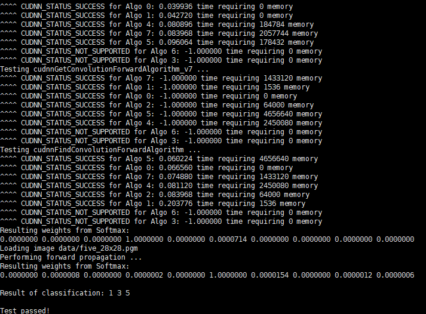

# 一、安装环境确认

| 环境 | ubuntu22.04 |
| :--: | :---------: |

```shell
# 查看GPU和型号
root@dell: lspci | grep -i nvidia

0000:01:00.0 VGA compatible controller: NVIDIA Corporation GA102 [GeForce RTX 3090] (rev a1)

# 然后禁用Linux自带驱动nouveau，先打开blacklist.conf文件：
sudo gedit /etc/modprobe.d/blacklist.conf


# 在blacklist.conf末尾添加以下两行，保存后关闭文本：
blacklist nouveau
options nouveau modeset=0

# 输入以下命令更新配置，更新结束后重启
sudo update-initramfs -u
```

# 二、安装CUDA Toolkit

 [cuda下载链接](https://developer.nvidia.com/cuda-downloads)

按照你的需求来，我这是选择的本地安装，就是下载一个安装包，在本地安装，deb类型的安装包是由APT管理，方便更新与卸载。



截止到目前位置为12.9版本 我这里安装的11.8，具体命令我这直接复制官网的，一条一条执行。

```shell
wget https://developer.download.nvidia.com/compute/cuda/repos/ubuntu2204/x86_64/cuda-ubuntu2204.pin
sudo mv cuda-ubuntu2204.pin /etc/apt/preferences.d/cuda-repository-pin-600
wget https://developer.download.nvidia.com/compute/cuda/11.8.0/local_installers/cuda-repo-ubuntu2204-11-8-local_11.8.0-520.61.05-1_amd64.deb
sudo dpkg -i cuda-repo-ubuntu2204-11-8-local_11.8.0-520.61.05-1_amd64.deb
sudo cp /var/cuda-repo-ubuntu2204-11-8-local/cuda-*-keyring.gpg /usr/share/keyrings/
sudo apt-get update
sudo apt-get -y install cuda
```

# 三、安装后的工作

设置环境变量，**是你安装版本的路径**

```
# 我这里的路径是
export PATH=/usr/local/cuda-11.8/bin${PATH:+:${PATH}}
```

永久生效，，添加到.bashrc配置文件里面

```
# 打开配置文件
vi ~/.bashrc
# 添加到最后一行，保存并退出
export PATH=/usr/local/cuda-12.5/bin${PATH:+:${PATH}}

# 重新激活配置文件
source ~/.bashrc
```

# 四、验证

验证CUDA版本，这是**runtime运行时**的版本
`nvcc -V`

验证驱动版本
`nvidia-smi` 

如下图则安装成



# 五、安装cudnn

 [cudnn 下载链接](https://developer.nvidia.com/rdp/cudnn-archive)

我向这里选择的11.8版本对应的cudnn 并上传到对应机器上



安装cudnn

```shell
sudo dpkg -i cudnn-local-repo-ubuntu2204-8.9.7.29_1.0-1_amd64.deb

sudo cp /var/cudnn-local-repo-ubuntu2204-8.9.7.29/cudnn-local-8AE81B24-keyring.gpg /usr/share/keyrings/

sudo apt-get update

# 先查看里面libcudnn8文件对应的版本是什么，手动更改相对应的版本即可
cd /var/cudnn*
```



安装这几个deb文件

```shell
sudo apt-get install libcudnn8=8.9.7.29-1+cuda11.8
sudo apt-get install libcudnn8-dev=8.9.7.29-1+cuda11.8
sudo apt-get install libcudnn8-samples=8.9.7.29-1+cuda11.8
```

# 六、验证cudnn

```shell
# 拷贝CUDNN的一个示例，编译看下是否可以正常运行
cp -r /usr/src/cudnn_samples_v8/ $HOME
cd  $HOME/cudnn_samples_v8/mnistCUDNN
make clean && make

# 可能出现 这个报错
test.c:1:10: fatal error: FreeImage.h: No such file or directory
    1 | #include "FreeImage.h"

# 安装libfreeimage3 libfreeimage-dev
sudo apt-get install libfreeimage3 libfreeimage-dev

# 重新 执行 make 
make clean && make

# 没有报错后测试
./mnistCUDNN
```

