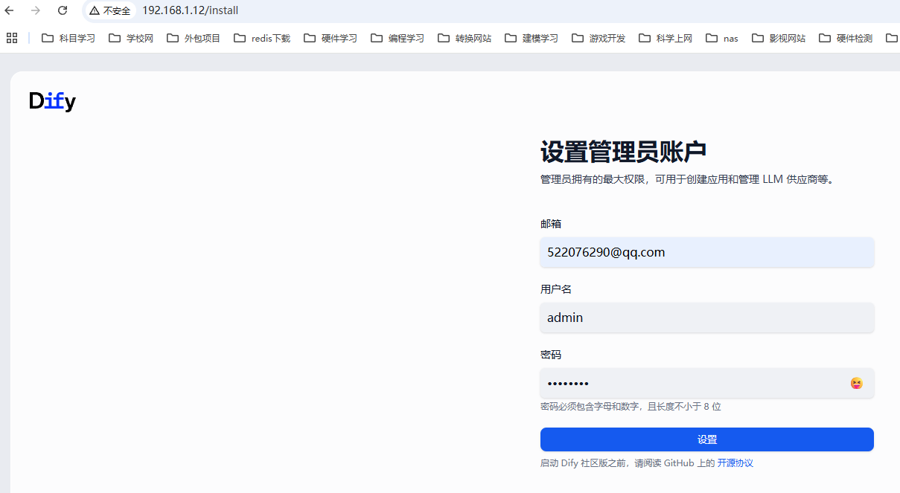

# dify搭建

| 操作系统 | Ubuntu22.04 |
| -------- | ----------- |
|          |             |

## 1.Docker安装	

更新软件包列表并安装依赖

```shell
sudo apt install apt-transport-https ca-certificates curl software-properties-common -y
```

添加 Docker 官方 GPG 密钥并安装 Docker 如果提示443 修改https为http：

```shell
# 获取GPG秘钥
curl -fsSL https://download.docker.com/linux/ubuntu/gpg | sudo gpg --dearmor -o /usr/share/keyrings/docker-archive-keyring.gpg

#更新包列表
sudo apt update

#安装docker
sudo apt install docker-ce docker-ce-cli containerd.io docker-buildx-plugin docker-compose-plugin -y

# 修改docker镜像源 如果实在用不了只能尝试代理了
sudo mkdir -p /etc/docker
sudo nano /etc/docker/daemon.json
{
	"registry-mirrors": ["https://hub-mirror.c.163.com", "https://docker.m.daocloud.io"]
}

# 重启docker服务
sudo systemctl daemon-reload
sudo systemctl restart docker


# 参考内容 
# Docker 使用代理（拉取镜像时）
# 新增一个代理配置文件
sudo mkdir -p /etc/systemd/system/docker.service.d
sudo nano /etc/systemd/system/docker.service.d/http-proxy.conf

# 写入下面内容 （注意127.0.0.1替换成你的代理地址）
[Service]
Environment="HTTP_PROXY=http://127.0.0.1:7890"
Environment="HTTPS_PROXY=http://127.0.0.1:7890"
Environment="NO_PROXY=localhost,127.0.0.1,docker-registry.somecorporation.com"

# 重启doker
sudo systemctl daemon-reload
sudo systemctl restart docker
```

## 2.docker compose安装

1.去github上找docker-compose的二进制文件

https://github.com/docker/compose/releases

然后上传到服务器上的`/usr/local/bin`目录下，不需要解压

2、添加可执行权限

```shell
chmod +x /usr/local/bin/docker-compose

#检验安装
docker-compose version
docker compose version
```

## 3.下载dify源码

```shell
# 克隆dify源码
git clone https://github.com/langgenius/dify.git

# 进入docker部署的文件夹
cd docker/

# 复制一个 env 文件
cp .env.example .env

# 一键启动 docker-compose
docker compose up -d

# 启动成功后访问 默认80端口即可或者是ip地址
127.0.0.1
```

成功后进入对应的后台地址



账号：admin

密码：admin123

到这里就部署成功了